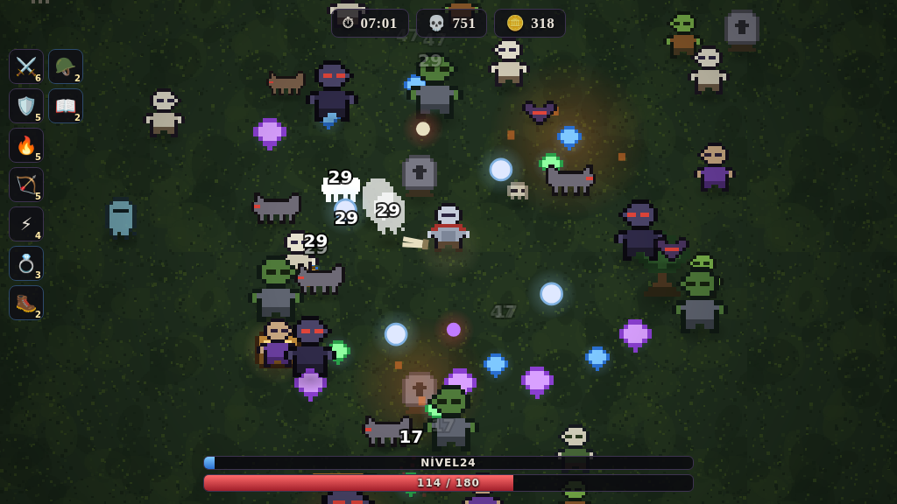

# ⚔️ Reino Sombrio

Um jogo de sobrevivência contra hordas no estilo **Vampire Survivors / Brotato**, só que
em versão **medieval**. Feito em HTML, CSS e JavaScript puro — sem nenhuma biblioteca,
sem instalar nada.

**7 heróis · 12 armas · 6 evoluções · 14 monstros · 4 chefes · 15 minutos para sobreviver
— e, se você cair, ainda tem o Purgatório. Sobreviveu aos 15? Entra o Ragnarök, que não acaba.**



## ▶️ Como jogar

**Jeito mais fácil:** baixe o arquivo **`reino-sombrio.html`** e abra com dois cliques.
Esse é o jogo inteiro espremido num arquivo só — não precisa de mais nada junto, roda
offline e dá para mandar por WhatsApp ou pendrive.

Se baixar o projeto completo, também dá para abrir o `index.html` (é a versão separada
em vários arquivos, usada para programar). Só lembre que o `index.html` **precisa** estar
acompanhado do `style.css` e da pasta `js/` — sozinho ele não funciona.

Se quiser jogar pelo celular ou mandar o link para alguém, dá para publicar de graça
com o GitHub Pages: em **Settings → Pages**, escolha a branch e salve. O jogo fica em
`https://nevviz54.github.io/Nevviz54/jogo-medieval/`.

## 🎮 Controles

| Ação | Teclado | Celular |
|------|---------|---------|
| Mover | `W A S D` ou setas | arraste o dedo na tela |
| Atacar | automático | automático |
| Pausar | `ESC`, `P` ou o botão ❚❚ | botão ❚❚ no canto da tela |
| Tela cheia | botão ⛶ | botão ⛶ |

Você só se preocupa em **desviar** — as armas atiram sozinhas no inimigo mais próximo.

## 🩸 Como funciona

- **Gemas azuis** dão experiência. Ao subir de nível você escolhe 1 de 3 cartas.
- **Moedas** ficam guardadas mesmo quando você morre e são gastas na **Ferraria**
  (melhorias permanentes que valem para todas as próximas partidas).
- **Baús** caem de inimigos de elite (os que brilham em laranja) e dos chefes.
- **Ímã** 🧲 puxa todas as gemas do mapa de uma vez. **Ira Divina** ⚡ fulmina todo mundo
  na tela. Os dois são raros e caem de qualquer inimigo.
- **Chefes** aparecem aos 5, 10 e 15 minutos. Derrotar o **Rei Vampiro** é a vitória.
- Ao subir de nível, o botão 🔄 **troca as três cartas** oferecidas. São 2 trocas por
  partida (compre mais na Ferraria com o *Presságio*).
- Cuidado com o **Carniçal Inchado**, que explode ao morrer, e com a **Gosma Pútrida**,
  que se parte em duas menores e mais rápidas.
- O **cenário muda** junto com os chefes: campo → criptas → terra queimada.
- **Evoluções:** arma no nível MÁX + o item passivo certo no nível 5 = arma lendária.

| Arma no máximo | + Passivo nível 5 | = Evolução |
|---|---|---|
| Espada Longa | Anel de Poder | **Excalibur** |
| Besta | Ampulheta | **Balista Sagrada** |
| Aura Sagrada | Coração de Leão | **Círculo Divino** |
| Fogo Grego | Tomo Antigo | **Inferno Sagrado** |
| Lança Longa | Botas de Couro | **Gungnir** |
| Sopro Gélido | Armadura | **Inverno Eterno** |

## ⚰️ O Purgatório

Quando você cai, a partida **não acaba na hora**. Uma porta se abre e você pode recusar
a morte **uma vez por partida** para duelar com **Mordrek, o Ceifador de Almas** —
usando exatamente as armas, os níveis e os atributos que tinha no momento da queda
(a vida volta cheia para o duelo).

É um duelo dentro de um círculo fechado, sem horda e sem relógio. Mordrek tem três
fases: na primeira ele ceifa e manda anéis de almas; na segunda começa a sumir e
reaparecer; na terceira enlouquece e cobre a arena de espirais.

- **Venceu** → sua alma sobe para **Valhalla**: prêmio em ouro e a **Valquíria** liberada.
- **Perdeu** → sua alma afunda em **Helheim**, o reino frio de quem não venceu. O ouro
  da partida fica guardado do mesmo jeito.

## ♾️ Ragnarök (modo infinito)

Depois de derrotar o Rei Vampiro você pode **continuar jogando**. A dificuldade não tem
mais teto, os chefes voltam a cada 2 minutos e o cenário fica girando. O recorde passa a
ser simplesmente: quanto tempo você aguentou.

## 📊 Relatório de fim de partida

Toda partida termina mostrando **de onde veio o seu dano**, arma por arma, e quem te
derrubou. É a forma mais rápida de descobrir se aquela arma que você vem subindo está
carregando a build ou só ocupando espaço.

## 🧙 Heróis

| Herói | Arma inicial | Estilo |
|-------|--------------|--------|
| 🛡️ Cavaleiro | Espada Longa | resistente, bom para começar |
| 🏹 Arqueiro | Besta | rápido e de longe |
| 🔮 Bruxa | Fogo Grego | frágil, mas com muita área |
| 🪓 Bárbaro | Machado Giratório | muita vida e dano, mas lento (400 🪙) |
| 🗡 Ladino | Adagas Velozes | o mais rápido, vive de críticos (450 🪙) |
| ✨ Paladino | Aura Sagrada | armadura e regeneração (600 🪙) |
| ⚡ Valquíria | Relâmpago Divino | **só vencendo Mordrek no Purgatório** |

## 📁 Organização do código

```
jogo-medieval/
├── index.html           → estrutura das telas (menu, loja, HUD)
├── style.css            → visual da interface
├── js/
│   ├── utils.js         → funções de matemática, grade de colisão e salvamento
│   ├── audio.js         → música e efeitos gerados na hora (Web Audio API)
│   ├── art.js           → a pixel art, desenhada por código a partir de mapas de texto
│   ├── data.js          → CONTEÚDO: heróis, armas, monstros, chefes e loja
│   └── game.js          → o motor: laço principal, colisões, desenho e telas
├── construir.js         → junta tudo num arquivo só (rode: node construir.js)
└── reino-sombrio.html   → gerado pelo construir.js, é o jogo em arquivo único
```

⚠️ O `reino-sombrio.html` é **gerado automaticamente**. Não edite ele direto: mexa nos
arquivos de origem e rode `node construir.js` de novo, senão suas mudanças somem.

## 🔧 Quer mexer no jogo?

Quase tudo o que dá vontade de mudar está em **`js/data.js`**:

- Deixar uma arma mais forte → mexa no `dano` dentro de `stats(n)`.
- Criar um monstro novo → copie um bloco em `MONSTROS` e mude nome, vida e velocidade.
  O campo `desde` é o segundo em que ele começa a aparecer.
- Mudar os chefes → lista `CHEFES` (o campo `tempo` é quando ele aparece).
- Preço das melhorias → lista `LOJA`.

E em **`js/art.js`** os desenhos são mapas de texto: cada letra é uma cor da paleta e
`.` é transparente. Dá para desenhar um monstro novo só escrevendo linhas de texto.

Para mudar quanto tempo dura a partida, procure `DURACAO` no começo do `js/game.js`.

---

Feito para o **D.F.B.G PRODUCTIONS** 🎮
